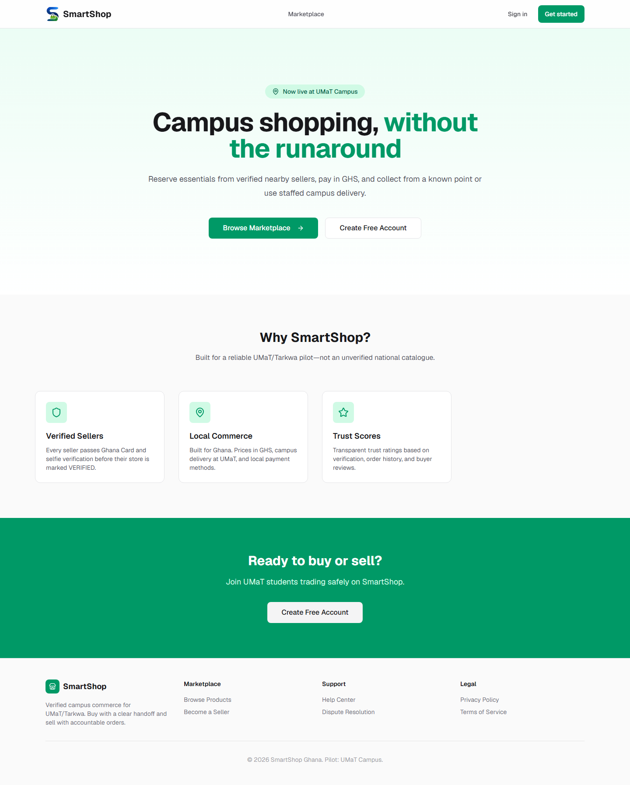
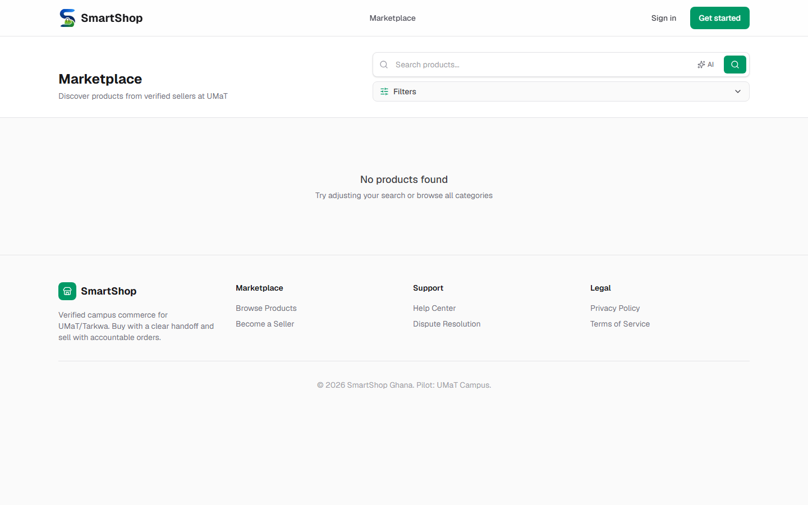
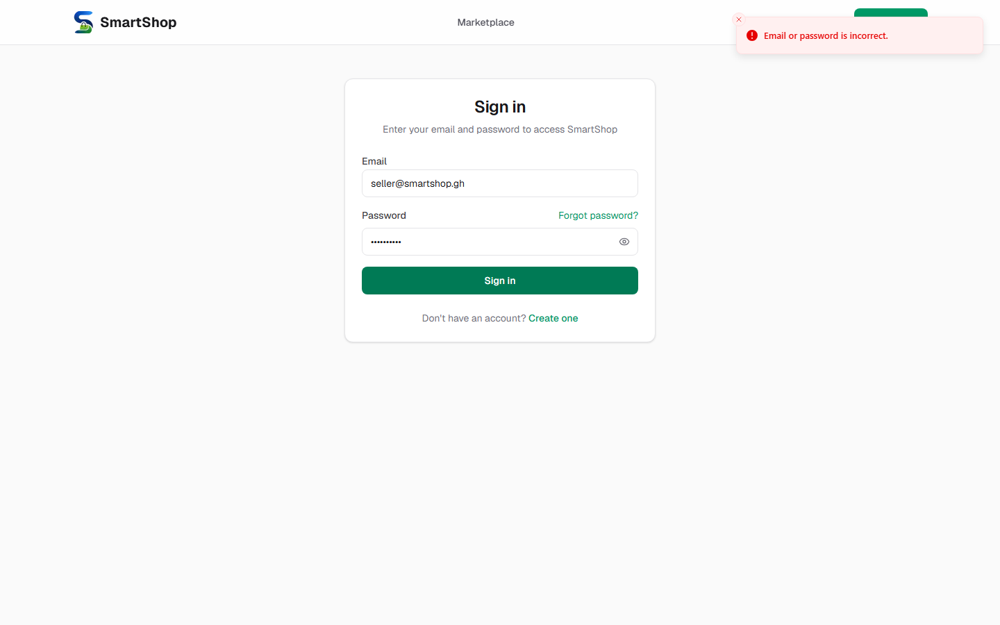
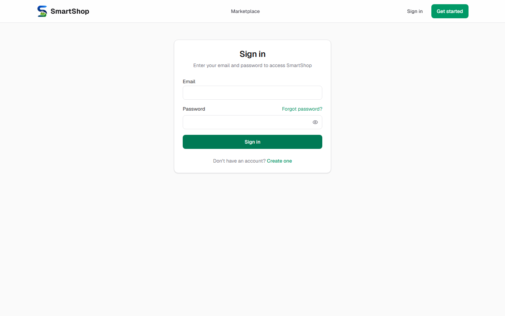
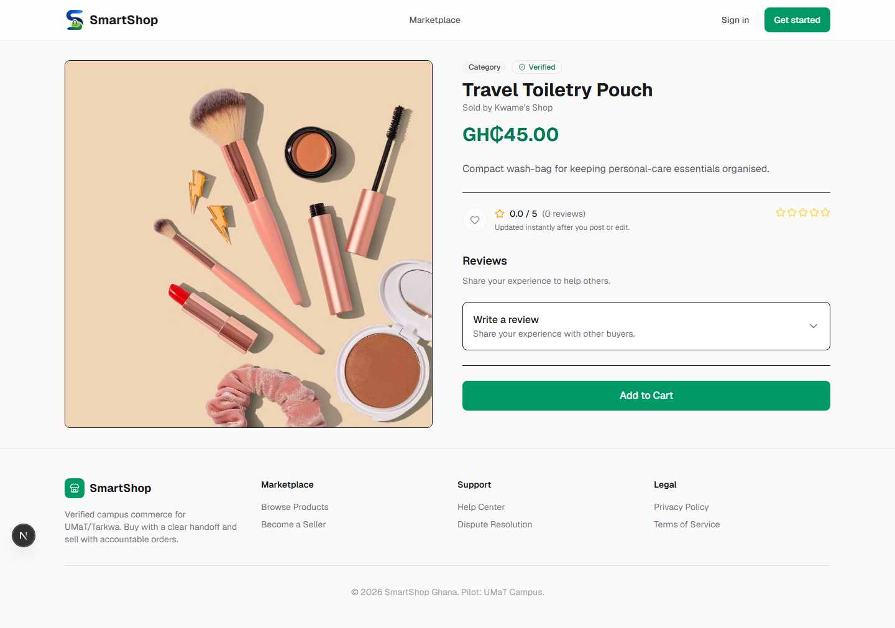

# SmartShop

**Trust-first local commerce for the UMaT, Tarkwa pilot.**

SmartShop helps students reserve everyday essentials from verified nearby sellers, pay in Ghana cedis, and choose a known pickup point or campus delivery. It is intentionally designed as a tightly operated local marketplace—not an unverified nationwide catalogue.

> This repository is currently a pilot-stage product. See [Launch Readiness](docs/LAUNCH_READINESS.md) for the operating, compliance, and payment work required before a public launch.

## Why SmartShop

Buying locally should not mean guessing whether a seller is real, an item is available, or how it will arrive. SmartShop combines seller verification, transparent order totals, buyer-facing order records, pickup codes, and delivery tracking into one experience.

### What is included

- Buyer marketplace with product search, categories, product details, cart, wishlist, promotions, reviews, messaging, and order history.
- Ghana-focused checkout in GHS with Mobile Money or card payment options, Paystack integration, pickup, and campus-delivery quotes.
- Seller workspace for verification, stores, catalogue and inventory, orders, payouts, customers, promotions, analytics, subscriptions, and AI-assisted listing content.
- Admin tools for seller and store verification, subscription management, dispute review, marketplace analytics, delivery operations, and settlement tracking.
- Safeguards including role-based access, CSRF protections, rate limiting, private verification-document storage, webhook validation, and audit-oriented fulfilment states.

## Product preview

The repository includes a short, privacy-safe walkthrough recorded against the local development environment. It covers the public landing and marketplace surfaces, then signs in with the seeded seller account to show the seller workspace. It deliberately excludes payment submission and identity-document views.

[Watch the local product walkthrough](docs/assets/demo.webm)









For a future external launch, add the remaining assets below; they tell the product story better than a large gallery of isolated screens.

| Asset | Capture this exact state | Suggested file |
| --- | --- | --- |
| Hero screenshot | Desktop home page, showing the UMaT positioning and primary buyer/seller actions | `docs/assets/home.png` |
| Buyer journey | Mobile marketplace/product page with a verified-seller badge, price in GHS, stock, and add-to-cart action | `docs/assets/buyer-product.png` |
| Checkout | Desktop checkout with a populated order, a pickup/delivery choice, and the transparent total breakdown; use mock data only | `docs/assets/checkout.png` |
| Seller workflow | Seller dashboard with realistic product, order, balance, and verification status data | `docs/assets/seller-dashboard.png` |
| Trust operations | Admin verification or fulfilment/settlement queue with all personal document data redacted | `docs/assets/admin-operations.png` |
| Demo video | A 60–90 second silent, captioned walkthrough: browse → add to cart → delivery/pickup choice → payment handoff → seller fulfils order → admin verifies seller | `docs/assets/demo.gif` or a linked YouTube/Loom video |

When the remaining files exist, add them alongside the current previews:

```md



[Watch the 90-second product walkthrough](REPLACE_WITH_DEMO_URL)
```

Do not use customer names, phone numbers, addresses, Ghana Card images, selfies, payment references, or real order data in screenshots or recordings. Use development seed data and scrub identifiers before recording.

## Architecture

SmartShop is a TypeScript modular monolith. Its product surfaces and business rules stay in one deployable application for fast pilot iteration, while the internal boundaries leave room to extract workers and other services as the operation grows.

| Area | Technology |
| --- | --- |
| Web application | Next.js 16, React 19, TypeScript, Tailwind CSS |
| Client/server API | tRPC 11, TanStack Query, Zod |
| Data | PostgreSQL 16, Prisma 7 |
| Cache and short-lived flows | Redis / Upstash Redis |
| Files | S3-compatible object storage (MinIO locally) |
| Payments | Provider abstraction with Paystack support |
| AI assistance | OpenAI-compatible provider abstraction |
| Testing | Vitest and Playwright |
| Deployment | Docker and Kubernetes manifests |

```text
Browser
  └─ Next.js App Router pages and route handlers
       ├─ tRPC routers (typed API boundary)
       ├─ server/services (business rules)
       ├─ Prisma → PostgreSQL
       ├─ Redis (rate limits and ephemeral workflows)
       └─ S3-compatible storage (public product media; private verification files)
```

For deeper decisions, scaling assumptions, security model, and order flow, read [Architecture](docs/ARCHITECTURE.md).

## Repository map

```text
app/                 Next.js routes, pages, and API handlers
components/          Shared UI plus marketplace, seller, admin, and auth components
server/services/     Business rules for orders, payments, fulfilment, trust, and more
server/trpc/         Typed API routers and tRPC setup
lib/                 Auth, storage, payments, AI, Redis, environment, and UI utilities
prisma/              Prisma schema, migrations, and repeatable local seed data
tests/               Unit and end-to-end test suites
docs/                Product thesis, architecture, launch readiness, and operations docs
docker/ and k8s/     Container and deployment definitions
```

## Run locally

### Prerequisites

- Node.js 20 or newer
- pnpm 9 (the repository pins `pnpm@9.15.0`)
- Docker Desktop, for PostgreSQL and MinIO

### 1. Start local services

```bash
docker compose up -d postgres minio
```

For the complete local experience, including rate-limited and short-lived flows, start Redis through its local profile:

```bash
docker compose --profile local-redis up -d redis
```

### 2. Install, migrate, seed, and start

```bash
pnpm install
pnpm db:migrate
pnpm db:seed
pnpm dev
```

Open [http://localhost:3000](http://localhost:3000). The seed creates local pilot locations, delivery zones, subscription offerings, a demo seller/store/catalogue, and a development administrator.

Development-only accounts:

| Role | Email | Password |
| --- | --- | --- |
| Administrator | `admin@smartshop.gh` | `Adminlan!` |
| Demo seller | `seller@smartshop.gh` | `Seller123!` |

These credentials are intentionally local-only fixtures. Never deploy them, reuse their passwords, or expose seed data as a production account.

## Configuration

The app validates configuration in [`lib/config/env.ts`](lib/config/env.ts). For local development, sensible defaults cover PostgreSQL, MinIO, JWT, and CSRF values. Configure the following explicitly for any shared or production environment:

| Purpose | Variables |
| --- | --- |
| Application and database | `APP_URL`, `DATABASE_URL`, optional `DATABASE_READ_URL` |
| Session security | `JWT_SECRET`, `CSRF_SECRET` |
| Redis | `REDIS_URL` or Upstash `UPSTASH_REDIS_REST_URL`, `UPSTASH_REDIS_REST_TOKEN` |
| Object storage | `S3_ENDPOINT`, `S3_REGION`, `S3_ACCESS_KEY_ID`, `S3_SECRET_ACCESS_KEY`, bucket names, `S3_PUBLIC_URL` |
| Payments | `PAYMENT_PROVIDER`, `PAYSTACK_SECRET_KEY`, `PAYSTACK_WEBHOOK_SECRET`, `PAYSTACK_CALLBACK_URL` |
| Notifications | `SMTP_*`, `SMS_PROVIDER`, `SMS_API_KEY`, `SMS_SENDER_ID` |
| AI | `AI_API_KEY`, `AI_BASE_URL`, `AI_MODEL`, `AI_MAX_TOKENS` |
| Operations | `CRON_SECRET`, rate-limit settings, `LOG_LEVEL`, `OTEL_ENABLED`, pilot-campus settings |

Never commit `.env` files or real keys. Product images may be public, but verification documents must use a private bucket and controlled, time-limited access.

## Quality checks

```bash
pnpm lint
pnpm test
pnpm test:e2e
pnpm build
```

Run database migrations before reseeding whenever the schema changes:

```bash
pnpm db:migrate
pnpm db:seed
```

## Fulfilment and money flow

1. A buyer places a pickup or eligible campus-delivery order and completes payment.
2. Pickup orders receive a short collection code. Campus delivery creates a delivery task.
3. A delivery task moves through `UNASSIGNED → ASSIGNED → PICKED_UP → DELIVERED`.
4. Order records separate merchandise subtotal, marketplace fee, delivery revenue, seller payout, and payment state.
5. Seller settlement is held for buyer protection and released only through the administered settlement workflow.

The application provides operational tooling; it does not claim automatic biometric matching and does not act as an escrow provider.

## Production launch notes

Before accepting public orders, complete the unresolved external and operational controls in [Launch Readiness](docs/LAUNCH_READINESS.md), including payment reconciliation, delivery proof and runner standards, document retention, Ghana data-protection review, refund/dispute processes, real SMS testing, and production webhook testing.

The pilot’s measure of success is repeated, on-time, positive-margin fulfilled orders—not registrations, listings, or gross merchandise value alone. The product thesis and expansion gates are documented in [SmartShop Thesis](docs/SMARTSHOP_THESIS.md).

## Contributing

1. Create a focused branch.
2. Keep business rules in `server/services/` and expose them through typed tRPC routers rather than duplicating rules in UI components.
3. Add or update tests for changed behaviour.
4. Run lint, unit tests, and a production build before opening a pull request.
5. Do not add secrets, production personal data, or verification documents to the repository.

## License

No license file is currently included. Until one is added, all rights are reserved by the repository owner.
